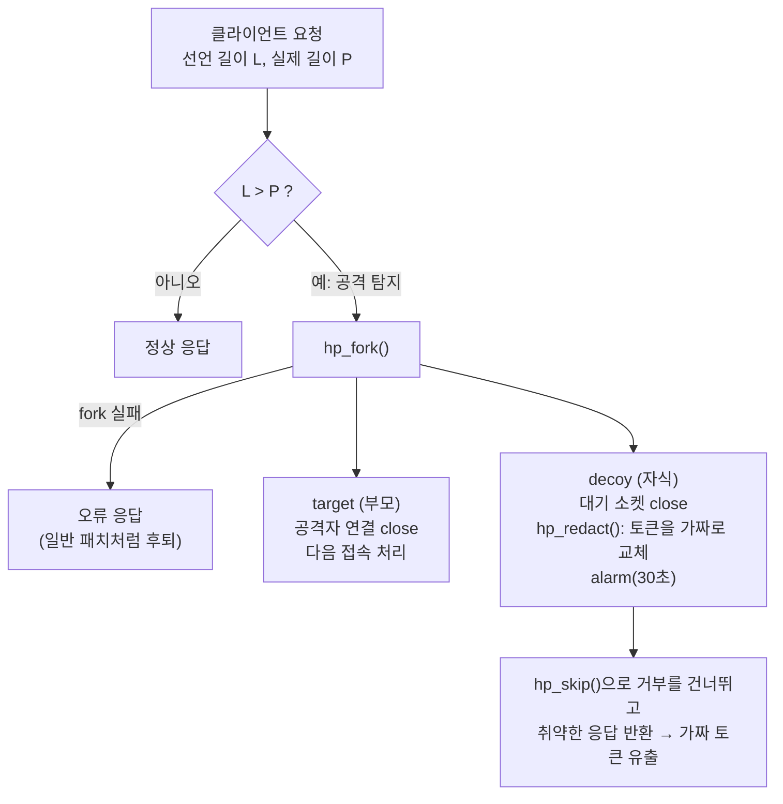

<div align="center">

# HoneyPatch

**취약점을 "막는" 대신, 공격자를 "속이는" 패치**


</div>

- 논문: From Patches to Honey-Patches: Lightweight Attacker Misdirection, Deception, and Disinformation
- 팀 번호: 08

Heartbleed 형태의 over-read 취약점을 가진 TCP 서버를 만들고, 같은 취약점에 **일반 패치**(오류 응답)와 **허니패치**(decoy로 분기해 가짜 비밀을 응답)를 각각 적용해 비교합니다. 공격이 들어오면 서버를 `fork()`로 복제해 공격자를 미끼(decoy)로 넘기고, 복제본 안의 비밀은 가짜로 바꿔 공격자가 공격에 성공했다고 믿게 만듭니다.

## 빠른 시작

```bash
git clone https://github.com/cocoa030722/2026-SSS-HoneyPatch.git
cd 2026-SSS-HoneyPatch
make test
```

gcc, make, python3가 필요합니다. 자세한 환경과 설치 방법은 [실행 환경](#4-실행-환경), [설치](#5-설치)를 보세요.

## 목차

1. [배경 지식](#1-배경-지식)
2. [동작 원리](#2-동작-원리)
3. [프로젝트 구조](#3-프로젝트-구조)
4. [실행 환경](#4-실행-환경)
5. [설치](#5-설치)
6. [실행](#6-실행)
7. [검증 사례](#7-검증-사례)
8. [원논문과의 차이](#8-원논문과의-차이)
9. [참고 자료](#9-참고-자료)

---

## 1. 배경 지식

### 취약점: Heartbleed (over-read)

서버는 클라이언트가 보낸 데이터 `payload`를 **L바이트만큼** 그대로 돌려라는 요청을 받습니다.
문제는 서버가 **클라이언트가 실제로 보낸 payload의 길이(P)** 와 **돌려달라고 요청한 길이(L)** 가 같은지 확인하지 않는다는 점입니다.

```
요청 :  payload = "ABCD" (실제 길이 P = 4바이트),  선언 길이 L = 64
응답 :  "ABCD"(4바이트) + (이어서 읽은 L - 4 = 60바이트)
```

서버의 전체 메모리는 다음과 같이 배치되기에 `L`을 키우면 바로 옆에 있는 `alice`, `bob`의 토큰이 유출될 수 있습니다.

```
 ┌────────┬──────────────┬──────────────┬──────────────┬──────────────┐
 │  hb    │  sess[0]     │  sess[1]     │  sess[2]     │  sess[3]     │
 │ (16B)  │  alice       │  bob         │  (guest)     │  (empty)     │
 │  buf   │  user+token  │  user+token  │  user+token  │              │
 └────────┴──────────────┴──────────────┴──────────────┴──────────────┘
   ▲ 여기서부터 L바이트를 읽는다 ───────────────▶  (NSLOT = 4 기준)
```

### 세 버전 서버

같은 소스(`src/server.c`)를 **컴파일 옵션만 달리해** 만듭니다.

| 서버 | 바이너리 | 컴파일 옵션 | `L > P` 요청이 오면 |
|---|---|---|---|
| **취약 서버** | `bin/vuln` | *(없음)* | 메모리를 그대로 읽어 **진짜 토큰 유출** |
| **일반 패치** | `bin/patch` | `-DPATCH` | **오류 응답**을 돌려줌 |
| **허니패치** | `bin/honey` | `-DHONEY` | **decoy로 포크**, 가짜 토큰이 든 응답을 돌려줌 |
| 허니패치 (비밀 삭제 OFF) | `bin/honey-noredact` | `-DHONEY -DNO_REDACT` | decoy로 포크하되 **토큰을 바꾸지 않음** (실험용) |

일반 패치와 허니패치는 **탐지 조건(`L > P`)이 같고 탐지 후의 동작만 다릅니다.**

| | 일반 패치 | 허니패치 |
|---|---|---|
| 탐지 시 동작 | 오류 응답 | decoy로 포크해 가짜 응답 |
| 공격자가 아는 것 | 서버의 패치 여부 | 교체된 가짜 토큰 |
| 진짜 비밀 노출 | 없음 | 없음 |
| 부가 효과 | 없음 | decoy가 공격자의 요청을 서버 로그에 기록 |

### 용어

| 용어 | 의미 |
|---|---|
| **victim** | 비밀 토큰을 가진 가상의 피해자(`alice`, `bob`). `tests/victims.txt`에 정의 |
| **target** | 원래 서버 프로세스. 공격 이후에도 정상 사용자의 요청을 계속 처리 |
| **decoy** | 공격 탐지 시 `fork()`로 만든 복제 프로세스. 공격자가 넘어가는 곳 |
| **redaction** | decoy 안의 진짜 토큰을 같은 형식과 길이의 가짜 값으로 덮어쓰는 것 |
| **slot** | 서버 메모리 안의 세션 칸. 한 칸에 `사용자 이름 8B + 토큰 24B` |
| **guest** | 서버에 접속한 일반 접속자. victim 다음 슬롯부터 배정됨 |

## 2. 동작 원리

### 허니패치 라이브러리 (`src/hp.h`, `src/hp.c`)

| 함수 / 매크로 | 역할 |
|---|---|
| `hp_init(listen_fd, log_fd)` | 대기 소켓과 로그 파일을 라이브러리에 등록 |
| `hp_fork(conn, slot, L, P)` | 세션을 decoy로 복제. `HP_TARGET` / `HP_DECOY` / `HP_FAIL` 반환 |
| `hp_skip(stmt)` | decoy가 **아닐 때만** `stmt`를 실행 (decoy에서는 패치의 거부 동작을 건너뜀) |
| `hp_in_decoy()` | 현재 프로세스가 decoy인지 확인 |
| `hp_redact(keep_slot)` | `keep_slot`을 제외한 모든 토큰을 같은 형식의 가짜 값으로 덮어씀 |
| `hp_log(fmt, ...)` | 로그 파일에 한 줄 기록 |

### 처리 흐름



| 단계 | 누가 | 하는 일 |
|:---:|---|---|
| 1 | 서버 | `L > P`인 요청을 **공격으로 탐지** (일반 패치와 같은 조건) |
| 2 | 서버 | `fork()`로 자기 자신을 복제 → **target**(부모)과 **decoy**(자식). 실패하면 일반 패치처럼 오류 응답 |
| 3 | target | 공격자 연결 소켓을 `close`하고 다음 접속을 받음 |
| 4 | decoy | 대기 소켓을 `close` (새 정상 사용자가 decoy에 배정되는 것을 방지) |
| 5 | decoy | `hp_redact()`로 **공격자 슬롯을 제외한 모든 세션의 토큰을 가짜로 교체** |
| 6 | decoy | `hp_skip()`으로 거부를 건너뛰고 공격자 연결에 취약한 응답을 그대로 반환 → **가짜 토큰이 나감** |
| 7 | decoy | 공격자가 연결을 끊으면 스스로 종료하고, 끊지 않아도 `DECOY_TTL`(30초)이 지나면 종료됨 |

`fork()`는 소켓 자체가 아니라 소켓을 가리키는 **파일 디스크립터(번호)** 만 복사합니다. 그래서 target이 `close`해도 decoy가 같은 소켓을 쥐고 있어 **공격자의 연결은 끊기지 않습니다.**

---

## 3. 프로젝트 구조

```text
2026-SSS-HoneyPatch/
├── Makefile                 # 빌드 및 테스트 진입점
├── README.md
├── src/
│   ├── common.h             # 상수, 세션/메모리 구조체 정의
│   ├── hp.h / hp.c          # 허니패치 라이브러리
│   └── server.c             # Heartbleed 취약점이 있는 TCP 서버 (서버 버전들의 공통 소스)
└── tests/
    ├── victims.txt          # 가상 피해자(alice, bob)와 진짜 토큰
    ├── cases_fixed.csv      # 고정 검증 사례 (수정 금지)
    ├── client.py            # 하트비트 클라이언트
    └── run_cases.py         # 명령행 검증 도구
```

`bin/`(빌드 결과)과 `logs/`(서버 로그)는 실행할 때 만들어지며 저장소에는 올리지 않습니다.

## 4. 실행 환경

| 항목 | 내용 |
|---|---|
| OS | Ubuntu 22.04 (Windows 11, WSL2) |
| 언어·버전 | C (`gcc` 11.4, `-std=gnu11`), GNU Make, Python 3.10 |
| 필요한 패키지 | `build-essential`(gcc, make), `python3` (Python은 표준 라이브러리만 사용) |

Linux 전용이며, 서버는 `127.0.0.1`에만 바인딩합니다.

## 5. 설치

```bash
sudo apt update
sudo apt install -y build-essential python3
git clone https://github.com/cocoa030722/2026-SSS-HoneyPatch.git
cd 2026-SSS-HoneyPatch
```

## 6. 실행

```bash
make test
```

서버 4종을 빌드한 뒤 세 서버(취약·일반 패치·허니패치)를 차례로 띄워 검증 사례를 보내고 사례마다 판정과 근거를 출력합니다. 
(honey-noredact은 빌드는 되지만 사용하지 않는다.) 
마지막 줄이 `결과: 9/9 PASS`이면 모든 사례가 기대 판정과 일치한 것이며, 이때 종료 코드는 `0`입니다(하나라도 다르면 `1`).

출력 예시 (허니패치 서버의 위반 사례):

```
[violation] L=64 P=ABCD  판정: fork_noleak  (기대: fork_noleak)  -> PASS
    응답: 상태 OK, 64바이트  "ABCD............alice......"
    진짜 토큰 포함: 없음  |  decoy 포크: 예  |  공격 직후 정상 요청: 성공
```

- 서버는 `127.0.0.1`의 9100~9102번 포트만 사용합니다.
- `서버가 시작되지 않았습니다`가 나오면 이전 실행의 서버가 남은 것이므로 `pkill -f bin/` 후 다시 실행합니다.

## 7. 검증 사례

L은 요청이 주장하는 길이, \|P\|는 실제로 보낸 payload의 길이입니다. L이 \|P\|보다 크면 서버가 메모리의 다른 부분까지 읽어 주게 됩니다([배경 지식](#1-배경-지식) 참고).

| 구분 | 입력 | 기대 결과 |
| --- | --- | --- |
| 정상 | L = 4, P = `ABCD` (L = \|P\|) | 포크되지 않고 target이 `ABCD` 4바이트를 그대로 응답한다. |
| 위반 | L = 64, P = `ABCD` (L > \|P\|) | decoy로 포크된다. 공격자는 오류 없이 64바이트 응답을 받지만 응답에 다른 사용자의 진짜 토큰은 없다. target은 다른 사용자의 요청을 계속 정상 처리한다. |
| 경계 | L = 5, P = `ABCD` (L = \|P\| + 1) | 1바이트 초과도 탐지되어 decoy로 포크된다. 응답은 5바이트이며 진짜 토큰은 없다. |

판정 방법:

- 토큰 유출: `tests/victims.txt`에 있는 피해자 토큰(24자)이 응답 바이트에 포함되는지 검사
- 포크: 서버 로그의 `[DECOY] start` 줄이 요청 전보다 1 늘었는지 검사 (포크 여부는 응답이 아니라 서버 로그로만 판정)
- 정상 처리: 공격 직후 새 연결로 보낸 정상 요청(L = 4, `PING`)이 그대로 응답되는지 검사

---

## 8. 원논문과의 차이

- 세션 복제: CRIU 체크포인트, 복원 대신 같은 호스트에서 `fork()`를 사용합니다.
- 연결 유지: TCP repair로 연결 상태를 옮기는 대신, 자식 프로세스가 소켓을 물려받아 연결을 유지합니다.
- 격리: 컨테이너(LXC)가 없어 decoy가 target과 커널·권한·파일 시스템을 공유합니다.
- 구성 요소: 리버스 프록시, CR-Controller, decoy 풀이 없습니다. 공격 탐지와 `hp_fork()` 호출 위치(패치 조건문)는 원논문과 같습니다.
- 비밀 삭제 범위: 세션 슬롯의 토큰만 교체하며 사용자 이름은 남습니다.
- 대상: 실제 웹 서버 대신 메모리 배치를 고정한 단순 TCP 서버를 쓰며, 연결을 하나씩 순차 처리합니다.

## 9. 참고 자료

- 원논문: From Patches to Honey-Patches: Lightweight Attacker Misdirection, Deception, and Disinformation
- 참고한 코드·라이브러리: 없음 (C 표준 라이브러리와 POSIX 소켓 API, Python 표준 라이브러리만 사용)
- AI 활용: Claude(Anthropic) — 구현 코드 작성, 동작 설명, 문서 초안