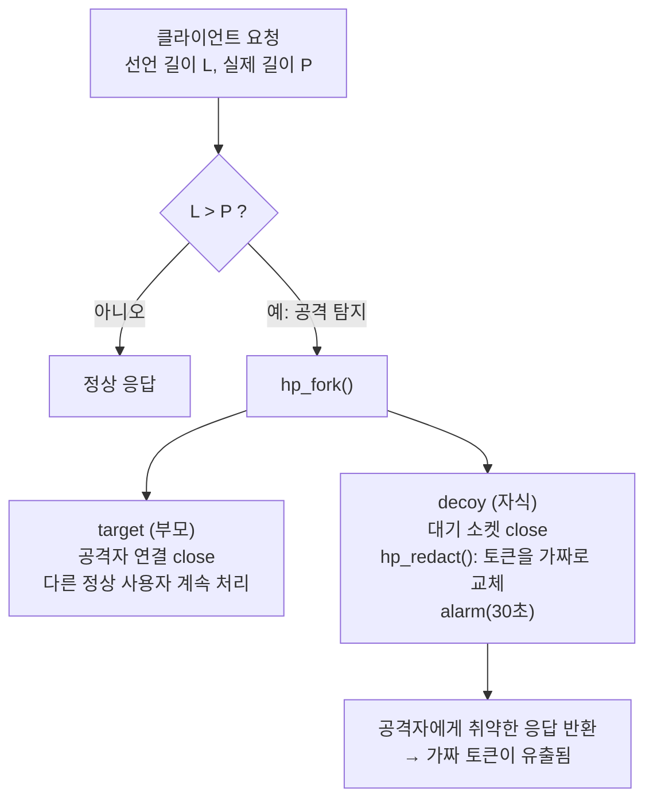

<div align="center">

# HoneyPatch

**취약점을 "막는" 대신, 공격자를 "속이는" 패치**

Heartbleed 형태의 취약점 위에서 *일반 패치*와 *허니패치*를 직접 비교해 보는 실습용 프로젝트


</div>

---

## 목차

1. [HONEY-PATCH](#honey-patch)
2. [배경 지식](#배경-지식)
3. [세 가지 서버 비교](#세-가지-서버-비교)
4. [빠른 시작](#빠른-시작)
5. [실행 결과 예시](#실행-결과-예시)
6. [동작 원리](#동작-원리)
7. [프로젝트 구조](#프로젝트-구조)
8. [빌드 옵션과 설정](#빌드-옵션과-설정)
9. [검증 사례 추가하기](#검증-사례-추가하기)

---

## HONEY-PATCH

> 공격이 들어오면 **오류를 돌려주는 대신**, 서버의 복제본(**decoy**)을 만들어 공격자를 그쪽으로 넘기고,
> 복제본 안의 비밀은 **가짜로 바꿔서** 공격자가 "공격에 성공했다"고 믿게 만듭니다.

---

## 배경 지식

### 1. 취약점: Heartbleed (over-read)

서버는 "내가 보낸 데이터 `payload`를 **L바이트만큼** 그대로 돌려줘" 라는 요청(하트비트)을 받습니다.
문제는 서버가 **실제로 보낸 길이(P)** 와 **주장한 길이(L)** 가 같은지 확인하지 않는다는 점입니다.

```
요청 :  payload = "ABCD" (실제 길이 P = 4바이트),  선언 길이 L = 64
응답 :  "ABCD" + (메모리에서 이어서 읽은 60바이트)
```

이 프로젝트의 서버는 메모리를 아래처럼 배치해 두었기 때문에, `L`을 키우면 바로 옆의 `alice`, `bob`의 토큰이 응답에 섞여 나옵니다.

```
 ┌────────┬──────────────┬──────────────┬──────────────┬──────────────┐
 │  hb    │  sess[0]     │  sess[1]     │  sess[2]     │  sess[3]     │
 │ (16B)  │  alice       │  bob         │  (user1)     │  (user2)     │
 │  buf   │  user+token  │  user+token  │  user+token  │  user+token  │
 └────────┴──────────────┴──────────────┴──────────────┴──────────────┘
   ▲ 여기서부터 L바이트를 읽는다 ───────────────▶  (NSLOT = 4 기준)
```

### 2. 일반 패치 vs 허니패치

| | 일반 패치 | 허니패치 |
|---|---|---|
| **공격 탐지 조건** | `L > P` | `L > P` (동일) |
| **탐지 시 동작** | 오류 응답을 돌려줌 | decoy로 포크해 가짜 응답을 돌려줌 |
| **공격자가 아는 것** | "패치되었구나" → 다른 방법을 찾음 | "성공했다!" → 가짜 비밀을 훔쳐 감 |
| **진짜 비밀 노출** | 없음 | 없음 |
| **부가 효과** | 없음 | 공격자의 행동을 decoy에서 관찰·기록 가능 |

### 3. 용어 정리

| 용어 | 의미 |
|---|---|
| **victim** | 비밀 토큰을 가진 가상의 피해자 (`alice`, `bob`). `tests/victims.txt`에 정의 |
| **target** | 원래 서버 프로세스. 정상 사용자를 계속 상대함 |
| **decoy** | 공격 탐지 시 `fork()`로 만든 복제 프로세스. 공격자가 넘어가는 곳 |
| **redaction** | decoy 안의 진짜 토큰을 같은 형식의 가짜 값으로 덮어쓰는 것 |
| **slot** | 서버 메모리 안의 세션 칸. 한 칸에 `사용자 이름 8B + 토큰 24B` |
| **guest** | 서버에 접속한 일반 접속자. victim 다음 슬롯부터 배정됨 |

---

## 세 가지 서버 비교

같은 소스(`src/server.c`)를 **컴파일 옵션만 달리해** 세 가지 서버를 만듭니다.

| 서버 | 바이너리 | 컴파일 옵션 | `L > P` 요청이 오면 |
|---|---|---|---|
| **취약 서버** | `bin/vuln` | *(없음)* | 메모리를 그대로 읽어 **진짜 토큰 유출** |
| **일반 패치** | `bin/patch` | `-DPATCH` | **오류 응답**을 돌려줌 |
| **허니패치** | `bin/honey` | `-DHONEY` | **decoy로 포크**, 가짜 토큰이 든 응답을 돌려줌 |
| 허니패치 (삭제 끔) | `bin/honey-noredact` | `-DHONEY -DNO_REDACT` | decoy로 포크하되 **토큰을 지우지 않음** (실험용 대조군) |

---

## 빠른 시작

### 요구 사항

| 항목 | 버전 |
|---|---|
| OS | WSL2 Ubuntu 22.04 |
| 컴파일러 | `gcc` (C11 이상, `gnu11`) |
| 빌드 도구 | `make` |
| 검증 도구 | `python3` |

### 한 줄 실행

```bash
git clone https://github.com/cocoa030722/2026-SSS-HoneyPatch
cd 2026-SSS-HoneyPatch
make test
```

`make test`는 **① 세 서버를 빌드 → ② 서버를 띄움 → ③ 검증 사례를 전송 → ④ 판정을 출력**까지 자동으로 수행합니다.

### 직접 실행해 보기

```bash
make                                           # bin/ 아래에 서버 빌드
./bin/honey 9000 tests/victims.txt &           # 허니패치 서버를 9000 포트에 실행
tail -f hp.log                                 # 다른 터미널에서 로그 관찰
```

```bash
# 정상 요청 : "ABCD"를 4바이트만큼 돌려받는다
python3 -c "import sys; sys.path.insert(0,'tests'); import client; print(client.heartbeat(9000, 4, 'ABCD'))"

# 공격 요청 : "ABCD"를 보내고 64바이트를 돌려달라고 한다
python3 -c "import sys; sys.path.insert(0,'tests'); import client; print(client.heartbeat(9000, 64, 'ABCD'))"
```

---

## 실행 결과 예시

`make test`의 실제 결과를 요약하면 다음과 같습니다. (**9/9 PASS**)

| 사례 | 요청 (`L`, payload) | 취약 서버 | 일반 패치 | 허니패치 |
|---|---|---|---|---|
| `normal` | L=4, `ABCD` | `ok` | `ok` | `ok` |
| `violation` | L=64, `ABCD` | **`leak`** (진짜 토큰 노출) | `error` | `fork_noleak` |
| `boundary` | L=5, `ABCD` | `ok` | `error` | `fork_noleak` |

### 판정 기준

| 판정 | 의미 |
|---|---|
| `ok` | 정상 응답, 포크 없음, 진짜 토큰 없음 |
| `leak` | 정상 응답처럼 보이지만 **진짜 토큰이 노출됨** |
| `error` | 오류 응답 |
| `fork_noleak` | decoy로 포크, **오류 없이 응답**, 진짜 토큰 없음 |

### 핵심 관찰

```text
[violation] L=64  (취약 서버)  → "ABCD............alice......"   진짜 토큰 포함: alice   ← 유출!
[violation] L=64  (일반 패치)  → 상태 ERROR                      ← 공격자가 패치를 눈치챔
[violation] L=64  (허니패치)   → "ABCD............alice......"   진짜 토큰 포함: 없음    ← 속았다!
```

허니패치 서버의 응답은 취약 서버와 **겉보기에 똑같지만**, 안에 든 토큰은 전부 가짜입니다.

---

## 동작 원리

### 허니패치의 처리 흐름



### 단계별 설명

| 단계 | 누가 | 하는 일 |
|:---:|---|---|
| 1 | 서버 | `L > P` 인 요청을 **공격으로 탐지** (일반 패치와 같은 조건) |
| 2 | 서버 | `fork()`로 자기 자신을 복제 → **target**(부모)과 **decoy**(자식) |
| 3 | target | 공격자 연결 소켓을 `close`. 이후 정상 사용자만 상대 |
| 4 | decoy | 대기 소켓을 `close` (새 정상 사용자가 decoy에 배정되는 것을 방지) |
| 5 | decoy | `hp_redact()`로 **공격자 슬롯을 제외한 모든 세션의 토큰을 가짜로 교체** |
| 6 | decoy | 공격자 연결을 이어받아 취약한 응답을 그대로 반환 → **가짜 토큰이 나감** |
| 7 | decoy | 연결이 끝나거나 `DECOY_TTL`(30초)이 지나면 **스스로 종료** |

> `fork()`는 소켓 자체가 아니라 **파일 디스크립터(번호)** 만 복사합니다. 그래서 target이 `close`해도 decoy가 같은 소켓을 쥐고 있어 **공격자의 연결은 끊기지 않습니다.** 공격자는 서버가 바뀐 줄 모릅니다.

### 허니패치 라이브러리 (`src/hp.h`)

| 함수 / 매크로 | 역할 |
|---|---|
| `hp_fork(conn, slot, L, P)` | 세션을 decoy로 복제. `HP_TARGET` / `HP_DECOY` / `HP_FAIL` 반환 |
| `hp_skip(stmt)` | decoy가 **아닐 때만** `stmt`를 실행 (decoy에서는 패치의 거부 동작을 건너뜀) |
| `hp_in_decoy()` | 현재 프로세스가 decoy인지 확인 |
| `hp_redact(keep_slot)` | `keep_slot`을 제외한 모든 토큰을 같은 형식의 가짜 값으로 덮어씀 |
| `hp_log(fmt, ...)` | 로그 파일에 한 줄 기록 |

> 원 논문의 API를 **프로세스 수준**으로 단순화해 구현했습니다. (논문의 CRIU 체크포인트 대신 `fork()` 사용)

### 통신 프로토콜

| 방향 | 형식 | 비고 |
|---|---|---|
| 요청 | `[레코드 길이 2B][선언 길이 L 2B][payload P]` | 빅 엔디언, 레코드 길이 = `2 + P` |
| 응답 | `[상태 1B][길이 2B][데이터]` | 상태: `0x00` 정상 / `0x01` 오류 |

---

## 프로젝트 구조

```text
2026-SSS-HoneyPatch/
├── Makefile                 # 빌드 및 테스트 진입점
├── README.md
├── src/
│   ├── common.h             # 상수, 세션/메모리 구조체 정의
│   ├── hp.h / hp.c          # 허니패치 라이브러리
│   └── server.c             # Heartbleed 취약점이 있는 TCP 서버 (3가지 버전의 원본)
└── tests/
    ├── victims.txt          # 가상 피해자(alice, bob)와 진짜 토큰
    ├── cases_fixed.csv      # 고정 검증 사례
    ├── client.py            # 하트비트 클라이언트
    └── run_cases.py         # 명령행 검증 도구
```

---

## 빌드 옵션과 설정

### Make

| 명령 | 설명 |
|---|---|
| `make` | 네 가지 서버 바이너리를 `bin/`에 빌드 |
| `make test` | 빌드 후 고정 검증 사례 실행 |
| `make clean` | `bin/`과 로그 삭제 |
| `make NSLOT=64` | 세션 슬롯 수를 바꿔 빌드 (기본 4) |

---

## 검증 사례 추가하기

`tests/cases_fixed.csv`는 **수정하지 않고**, 새 CSV 파일을 같은 형식으로 만들어 실행합니다.

```csv
case,L,payload,expect_vuln,expect_patch,expect_honey
my_case,32,HELLO,leak,error,fork_noleak
```

```bash
python3 tests/run_cases.py tests/my_cases.csv
```

> 종료 코드는 **모든 사례가 기대 판정과 일치하면 `0`**, 하나라도 다르면 `1` 입니다. CI에서 그대로 쓸 수 있습니다.

### victim 수를 바꾸고 싶다면

현재 victim은 **2명으로 고정**입니다. 늘리려면 아래를 함께 수정해야 합니다.

- [ ] `src/common.h`의 `FIRST_GUEST_SLOT` 값 변경
- [ ] `tests/victims.txt`에 같은 수만큼 줄 추가
- [ ] `src/server.c`의 로그 메시지·주석(`slots 0-1`, `슬롯 2`) 수정

---

<div align="center">

<sub>2026 SSS · HoneyPatch</sub>

</div>
